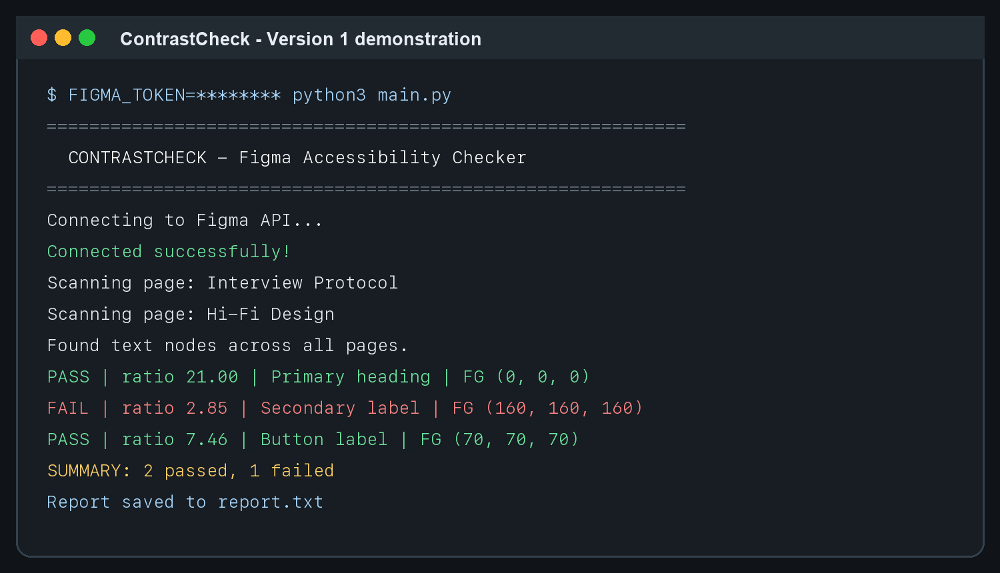
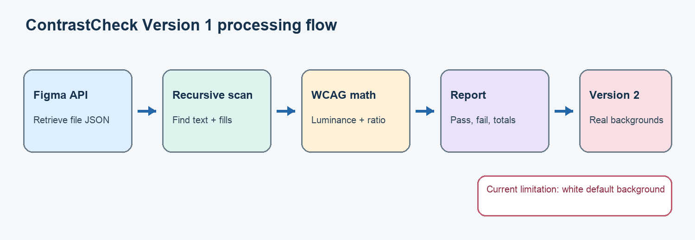

# ContrastCheck - Version 1 Review

**Student:** Heeral Chumber  
**Course:** HCI 584  
**Project:** ContrastCheck - Figma Accessibility Checker

## Short project overview

ContrastCheck is a Python tool for designers who want to find color-contrast problems in a Figma file before developer handoff. The tool connects to the Figma REST API, walks through the file's nested page and layer structure, extracts text colors, calculates WCAG contrast ratios, and produces a pass/fail report. The long-term goal is to reduce the amount of manual checking needed to catch accessibility problems early in the design process.

## What Version 1 implements

The core command-line workflow is working:

- Connects to the Figma REST API using a personal access token stored outside the source code.
- Downloads and reads a Figma file's JSON document structure.
- Recursively scans text layers across every page in the file.
- Extracts solid foreground colors from text nodes.
- Converts Figma color values into RGB values.
- Calculates relative luminance and WCAG contrast ratios.
- Marks results as PASS or FAIL using the WCAG AA 4.5:1 threshold.
- Removes repeated text/color results so the report is easier to read.
- Prints totals and saves the results to `report.txt`.
- Handles a missing API token with a clear message instead of exposing a token in the repository.

Version 1 is a functional proof of concept. It proves that the application can retrieve a real design file, navigate its nested data, and apply the core contrast formula. It is not yet a complete accessibility audit because the current report compares text against white by default.

## Current demonstration

Figure 1 shows the present command-line workflow. When configured with `FIGMA_TOKEN`, the program retrieves the selected file, reports each page as it scans, counts text nodes, calculates contrast results, and writes a text report.

**Figure 1.** Representative local demonstration of the Version 1 reporting flow. The sample nodes exercise the same extraction, WCAG calculation, duplicate filtering, and report-writing functions used by the live Figma workflow.

**Figure 2.** Current Version 1 processing flow and the boundary between implemented and future work.

## Issues encountered and responses

### 1. Figma files are deeply nested

**Issue:** Pages contain frames, components, groups, and child layers at many levels. Looking only at top-level nodes misses most text.

**Response:** I implemented recursive traversal so the program visits every child node and collects text layers from all pages.

### 2. Duplicate report entries

**Issue:** Repeated components and repeated text produced a very long report with many identical results.

**Response:** I added duplicate filtering based on the displayed text and foreground color. This makes the report shorter and more useful while retaining distinct text/color combinations.

### 3. API authentication and secret handling

**Issue:** An early version placed the Figma token directly in `main.py`, which is unsafe in a GitHub repository.

**Response:** The program now reads `FIGMA_TOKEN` from the environment, stops with a clear message when it is missing, and ignores `.env` files. The previously exposed token should be revoked and replaced.

### 4. Determining the real visible background

**Unresolved issue:** A text layer does not always contain its visible background. The background may come from a parent frame, a sibling rectangle, an image, transparency, or overlapping layers. The current Version 1 therefore checks against white.

**Proposed response:** First support the common case by tracking the nearest solid-filled ancestor while traversing the tree. Then test this with known examples. Complex cases such as images, gradients, opacity, and overlapping layers will be labeled as needing manual review instead of pretending the result is exact.

### 5. Scope of color-blindness simulation

**Unresolved issue:** The original proposal included visual color-blindness simulation, but accurate simulation and a visual interface would add substantial work before the core contrast checks are reliable.

**Proposed response:** Defer simulation until after background detection, testing, and report quality are complete. If time remains, add a small, clearly labeled prototype rather than a full simulation interface.

## Where help is needed

I would appreciate feedback on the appropriate scope for background detection. Specifically, is supporting the nearest solid-filled parent frame enough for this course project if the program clearly marks gradients, images, transparency, and overlapping layers for manual review? I would also like feedback on whether color-blindness simulation should remain a stretch goal or be removed entirely so that I can focus on making contrast detection dependable.

## Version 2 milestones

### Milestone 1 - Reliable background matching

Track parent context during recursive traversal and match each text node to the nearest usable solid background. Add an explicit "manual review" status when the visible background cannot be determined reliably.

### Milestone 2 - Verification and automated tests

Create small Figma test cases and Python tests for black/white contrast, threshold cases, duplicate handling, missing fills, nested frames, missing credentials, and API errors. This milestone depends on the background-matching rules being defined.

### Milestone 3 - More useful reports

Include text content, node ID, foreground color, background color, ratio, and reason for manual review. Add a summary that separates passes, failures, skipped nodes, and uncertain cases. This depends on Milestones 1 and 2.

### Milestone 4 - Designer-friendly input and documentation

Allow the user to supply a Figma URL or file key without editing the source code. Improve setup instructions, add a sample command, and explain how to keep the access token private. If time permits, add a minimal Flask form after the command-line workflow is stable.

### Milestone 5 - Optional color-blindness prototype

Only after the required milestones are complete, investigate one well-documented color-vision simulation method and apply it to selected color pairs. This remains a proposed nice-to-have feature.

## Self-reflection

I am satisfied that the project has moved from an idea and placeholder function to a working API-based proof of concept. Connecting to Figma and recursively finding text nodes was a meaningful step because it validated the basic technical approach. The contrast formula itself was easier than expected because WCAG provides a clear calculation. Understanding which background is actually visible behind a text layer was more difficult than expected because the Figma JSON describes a layered design rather than a simple list of foreground/background pairs.

The main course correction is to prioritize correctness and explain uncertainty. I originally imagined background detection, color-blindness simulation, and a Flask interface as one Version 1 experience. That is too broad for the remaining programming time. I can finish a useful project if I focus first on dependable contrast checks, testing, and clear reporting. A light-bulb moment was realizing that a responsible tool should say "manual review required" for complex cases rather than outputting a precise-looking but incorrect contrast score.

I believe the revised required scope is feasible within the remaining weeks. The browser interface and color-blindness simulation are now optional; they will not delay the core accessibility checker.
